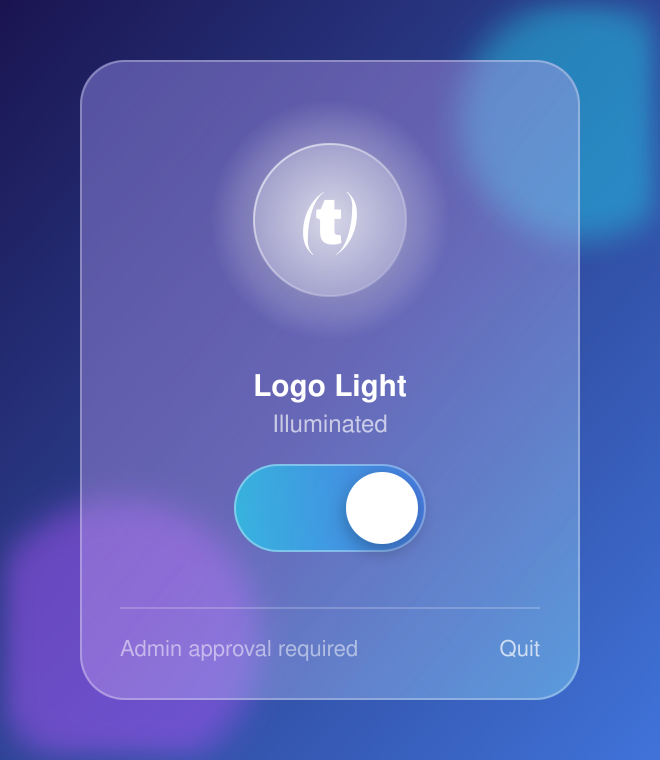

# GlowBar

<p align="center"></p>

A tiny, glassmorphic menu bar app that turns the backlit Apple logo on the
MacBook Pro on or off.

Under the hood it toggles:

```sh
sudo defaults write com.apple.CoreBrightness LEBacklightMode -int 0   # off
sudo defaults write com.apple.CoreBrightness LEBacklightMode -int 1   # on
```

GlowBar runs this through the standard macOS administrator prompt (password or
Touch ID), so it never stores credentials.



## Build

Requires macOS 13+ and Xcode or the Command Line Tools (Swift 5.9+).

```sh
./build.sh
open build/GlowBar.app
```

The app is menu bar only (no Dock icon). `build.sh` ad-hoc signs the bundle.
For distribution outside your own machine, sign with a Developer ID and
notarize it.

## Notes

- The current state is remembered by the app; if it starts out of sync, toggle once.
- The logo may need a display sleep/wake before it reacts.
- Not affiliated with Apple. Use at your own risk.

## License

MIT, see [LICENSE](LICENSE).
